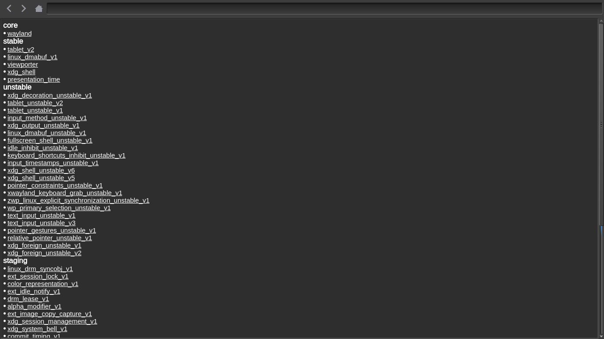
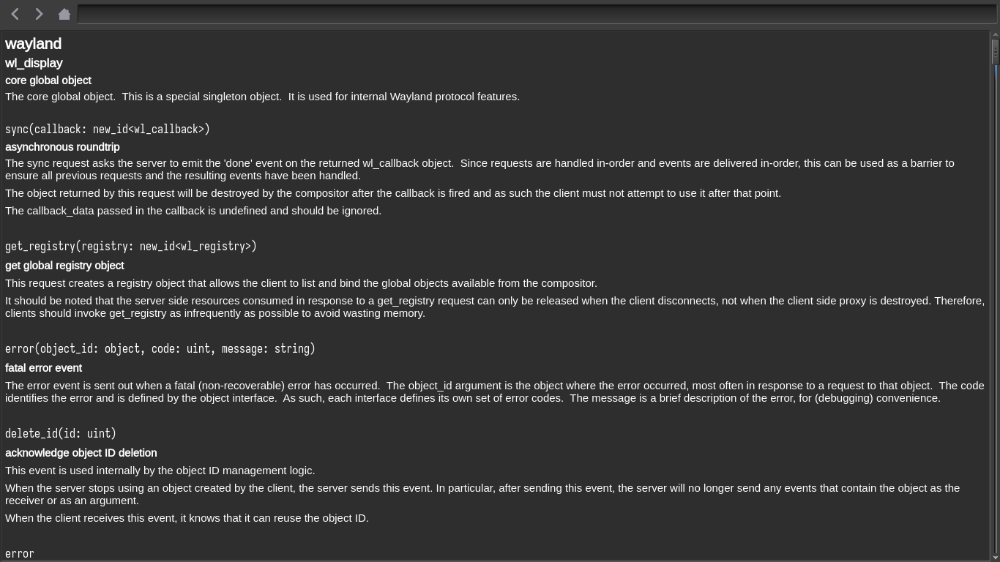

# Qt Wayland Docview

A local reader for wayland protocols documentation build with Qt.

## Features
- search
- basic navigation
- dunno what else

## Dependencies
- qt6-xml
- qt6-widgets
- wayland-protocols

## Building
``` shell
# if using make
cmake -B build -G "Unix Makefiles"
make -C build

# if using ninja
cmake -B build -G Ninja
ninja -C build && build/QtDocview
```

Screenshots, kvantum color scheme with arc icons


